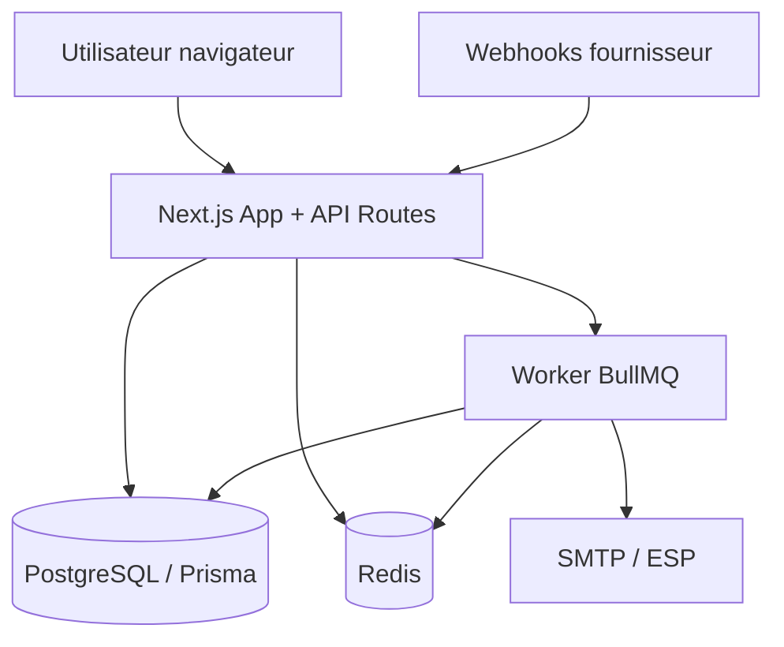
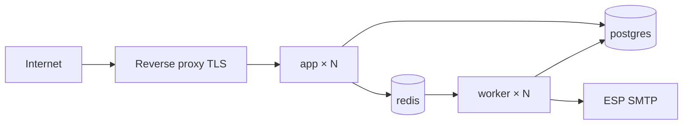
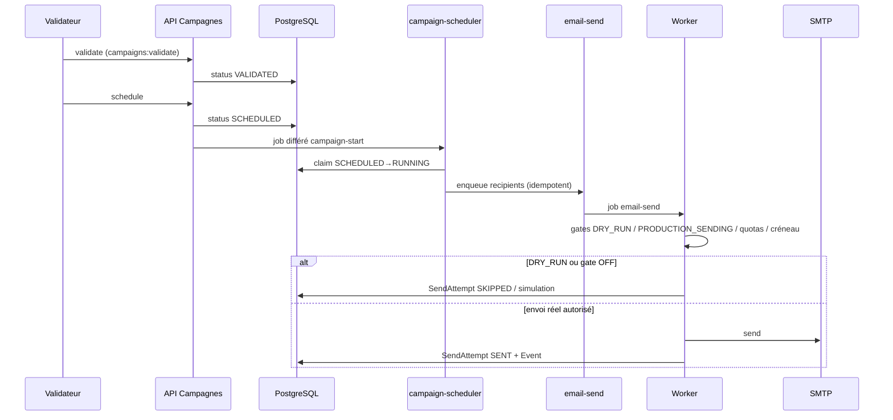

# Architecture — BotoSchool Email Platform

Plateforme interne de prospection email (Next.js 16 · Prisma 7 · PostgreSQL · Redis/BullMQ · Auth.js).

Gates CDC **non négociables** : `DRY_RUN`, `PRODUCTION_SENDING_ENABLED`, campagne **VALIDATED**, contacts **éligibles**.

---

## 1. Vue d'ensemble



| Composant | Rôle |
|---|---|
| **App** | UI dashboard + API Routes (auth, RBAC, métriques) |
| **Worker** | Processus séparé : envoi, imports, webhooks, scheduler campagnes |
| **PostgreSQL** | Source de vérité métier + audit |
| **Redis** | BullMQ, quotas, cache dashboard, rate-limit, heartbeats |
| **SMTP** | Relais unique via `MailProvider` (presets hôte/port) |

---

## 2. Diagramme de déploiement



Workers **obligatoires** pour l’envoi. Sans worker → files qui grossissent, aucun mail.

Stack locale monitoring : profile Docker `monitoring` (Prometheus / Grafana / Alertmanager) — voir [28-ETAPE-5-OBSERVABILITE.md](./implementation/28-ETAPE-5-OBSERVABILITE.md).

---

## 3. Séquence d'envoi (happy path)



### Règles critiques

1. Aucun envoi sans statut campagne `VALIDATED` (puis `SCHEDULED` / `RUNNING`).
2. `SendAttempt.idempotencyKey` **UNIQUE** — anti double SMTP même après retry.
3. Contenu figé au démarrage (version template).
4. Arrêt événementiel : bounce hard, unsubscribe, reply → stop séquence.

Détail moteur : [06-PHASE-4-CAMPAIGN-ENGINE.md](./implementation/06-PHASE-4-CAMPAIGN-ENGINE.md) · machines d’état : [06-STATE-MACHINES.md](./implementation/06-STATE-MACHINES.md).

---

## 4. Couches applicatives

Pas de framework DI lourd (tsyringe retiré). Pattern **modules** :

```
src/modules/{domaine}/
├── services/        # règles métier
├── repositories/    # Prisma
├── validators/      # Zod
└── (utils)
```

| Couche | Responsabilité |
|---|---|
| `app/api/**` | HTTP, auth, Zod parse, réponse |
| `services` | Logique métier, audit |
| `repositories` | Accès données (selects listes légers) |
| `lib/**` | Infra : auth, queue, mail, monitoring, security |
| `workers/**` | Consommateurs BullMQ |

---

## 5. Modules métier

| Module | Responsabilité |
|---|---|
| Auth / Users | Sessions Auth.js, RBAC |
| Organizations / Contacts | CRM léger, qualification, doublons |
| Imports | CSV/XLSX → validation → queue |
| Segments | Audiences dynamiques |
| Templates / Sequences | Contenu + 3 étapes max CDC |
| Campaigns | Workflow validation → envoi |
| Responses / Sales tasks | Inbound + qualification commerciale |
| Suppression | Liste d’exclusion |
| Audit / Compliance | Journal + CNDP (DSR, anonymisation, rétention) |
| Dashboard / Settings / Ops | KPIs, SMTP, DNS, monitoring |

---

## 6. Queues BullMQ

| Queue | Rôle |
|---|---|
| `email-send` | Envoi + retry / backoff |
| `email-dlq` | Échecs définitifs |
| `import-process` | Imports asynchrones |
| `webhook-process` | Webhooks ESP |
| `campaign-scheduler` | Démarrage / scan campagnes |

---

## 7. Sécurité & gates

- Headers + CSP + CSRF fail-closed (API mutantes)
- Rate-limit login / API / unsubscribe / probes
- Secrets : env Zod + Docker `*_FILE` + rotation JWT
- Envoi : `DRY_RUN` + `PRODUCTION_SENDING_ENABLED` + allowlist SMTP

Voir [27-ETAPE-4-SECURITY.md](./implementation/27-ETAPE-4-SECURITY.md).

---

## 8. Observabilité

- Health : `/api/health/live`, `/api/health/ready`
- Ops UI : `/ops`, `/ops/monitoring`, `/ops/smtp`, `/ops/dns`
- Métriques : `/api/ops/metrics?format=prometheus` (+ Bearer scrape)
- Logs Pino JSON + `correlationId` / `traceId`

---

## 9. Arborescence (réelle)

```
src/
├── app/                 # App Router (auth, dashboard, api)
├── components/          # UI
├── lib/                 # auth, config, db, mail, queue, monitoring, security…
├── modules/             # domaine métier
├── workers/             # processus BullMQ
└── generated/prisma/    # client Prisma 7
```

---

## 10. Décisions techniques

1. Prisma 7 + adapter PG, client dans `src/generated/prisma`
2. Next.js `output: "standalone"` pour Docker
3. Worker séparé (pas d’envoi dans le process HTTP)
4. Soft delete `deletedAt` sur entités principales
5. Audit systématique des mutations
6. Observabilité sans `prom-client` / sans SDK OTel (texte Prom + W3C léger)

---

## Guides

| Public | Doc |
|---|---|
| Développeur | [guides/DEVELOPER.md](./guides/DEVELOPER.md) |
| Administrateur | [guides/ADMIN.md](./guides/ADMIN.md) |
| Opérateur | [guides/OPERATOR.md](./guides/OPERATOR.md) |
| Production | [production/README.md](./production/README.md) |
| Modèle de données | [Database.md](./Database.md) |
| API | [API.md](./API.md) |
