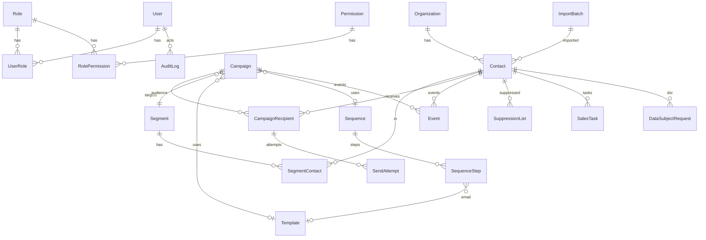
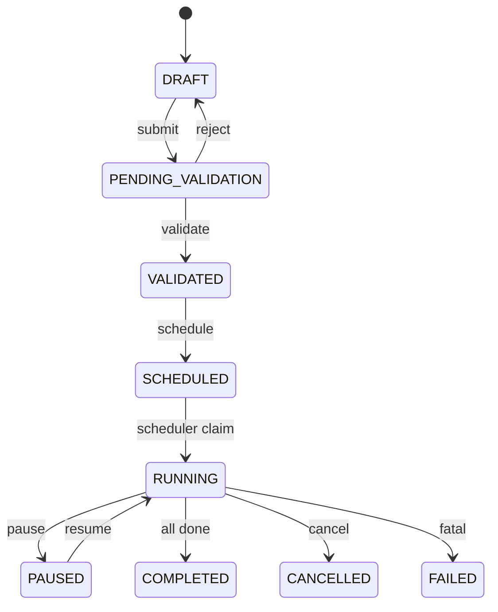

# Base de données — BotoSchool Email Platform

PostgreSQL 16 · Prisma ORM 7 · migrations versionnées dans `prisma/migrations/`.

Schéma source de vérité : [`prisma/schema.prisma`](../prisma/schema.prisma).

---

## 1. Diagramme entités (vue métier)



---

## 2. Domaines de tables

### Auth & RBAC

| Table | Description |
|---|---|
| `users` | Comptes (soft delete, status) |
| `roles` / `permissions` | RBAC granulaire |
| `user_roles` / `role_permissions` | Associations |
| `accounts` / `sessions` / `verification_tokens` | Auth.js |

### CRM & import

| Table | Description |
|---|---|
| `organizations` | Entreprises |
| `contacts` | Contacts, score, consent, doublons, éligibilité |
| `import_batches` | Historique imports CSV/XLSX |
| `email_duplicate_resolutions` | Résolutions de doublons |

### Audience & contenu

| Table | Description |
|---|---|
| `segments` / `segment_contacts` | Audiences |
| `templates` | Modèles HTML (version / contentHash) |
| `sequences` / `sequence_steps` | 3 emails max CDC |

### Campagnes & envoi

| Table | Description |
|---|---|
| `campaigns` | Workflow statuts + settings JSON |
| `campaign_recipients` | Destinataires, token unsubscribe, étape |
| `send_attempts` | Tentatives + **idempotency_key UNIQUE** |
| `events` | Ouverture, clic, reply, bounce… |
| `webhook_events` | Inbound ESP (idempotence provider) |

### Ops & conformité

| Table | Description |
|---|---|
| `audit_logs` | Journal actions |
| `suppression_list` | Exclusions |
| `sales_tasks` | Suivi commercial post-réponse |
| `app_settings` | Config applicative (secrets chiffrables) |
| `data_subject_requests` | Demandes CNDP (accès / effacement…) |

---

## 3. Enums clés

| Enum | Valeurs notables |
|---|---|
| `CampaignStatus` | DRAFT → PENDING_VALIDATION → VALIDATED → SCHEDULED → RUNNING → COMPLETED (+ PAUSED, CANCELLED, FAILED) |
| `ContactStatus` | NEW, QUALIFIED, DISQUALIFIED, CONTACTED, RESPONDED, BOUNCED, UNSUBSCRIBED… |
| `SendAttemptStatus` | QUEUED, PROCESSING, SENT, FAILED, BOUNCED, SKIPPED |
| `RecipientStepStatus` | PENDING, QUEUED, SENT, SKIPPED, STOPPED, FAILED… |
| `EventType` | EMAIL_SENT, OPENED, CLICKED, REPLIED, BOUNCED, UNSUBSCRIBED, COMPLAINT… |
| `SuppressionReason` | UNSUBSCRIBE, BOUNCE_HARD, COMPLAINT, MANUAL, GDPR… |
| `DataSubjectRequestType/Status` | Accès, rectification, effacement, opposition… |

---

## 4. Workflow campagne



---

## 5. Conventions

| Convention | Détail |
|---|---|
| Timestamps | `created_at` / `updated_at` |
| Soft delete | `deleted_at` : users, orgs, contacts, segments, templates, sequences, campaigns |
| Audit trail | `created_by_id` / `updated_by_id` |
| Emails | `email_normalized` pour unicité / matching |
| Indexes | Statuts, dates, FKs, filtres ops (Phase 11 + Étape 3) |

### Idempotence envoi

`send_attempts.idempotency_key` UNIQUE = anti double envoi (retry BullMQ, multi-worker).

### Désinscription

`campaign_recipients.unsubscribe_token` (cuid) → `/unsubscribe/{token}` → suppression list + stop séquence.

---

## 6. Commandes

```bash
npx prisma generate
npx prisma migrate dev --name <name>
npx prisma migrate deploy    # prod / staging
npx prisma db seed
npx prisma studio
npx prisma migrate status
```

---

## 7. Voir aussi

- [Architecture.md](./Architecture.md) — séquence d’envoi
- [guides/DEVELOPER.md](./guides/DEVELOPER.md) — migrations en local
- [production/10-CONFORMITE.md](./production/10-CONFORMITE.md) — CNDP / DSR
