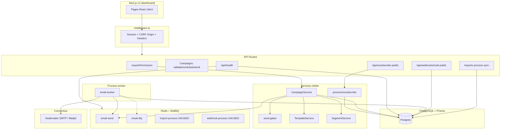

# Audit technique, fonctionnel et de sécurité — BotoSchool Emailing

| Métadonnée | Valeur |
|---|---|
| Projet | `botoschool-emailing` (workspace `hassan`) |
| Cahier des charges | `Cahier_des_charges_Automatisation_Emailing_BotoSchool(1).pdf` (12 pages, V1.0 — 25 juillet 2026) |
| Chemin PDF source | `C:\Users\User\Downloads\Cahier_des_charges_Automatisation_Emailing_BotoSchool(1).pdf` |
| Date d’audit | 2026-07-27 |
| Méthode | Analyse code + exécution tests non destructifs (`vitest`, `tsc`, `eslint`, `npm audit`) |
| Envois réels | Aucun |
| Décision | **NO-GO** (plusieurs P0 ouverts) |
| Score maturité | **50 / 100** |

---

## 0. Synthèse exécutive

### État général

La plateforme est une **base V1 avancée** : Next.js App Router, Prisma/PostgreSQL, Auth.js + RBAC serveur, modules UI, gates CDC (`DRY_RUN`, éligibilité, désinscription), worker BullMQ email, audit, dashboard branché sur la base. Ce n’est **pas** une façade vide.

Cependant, plusieurs **verrous critiques du CDC sont incomplets ou non branchés** : arrêt automatique après réponse non câblé, webhooks non sécurisés / non traités, unicité email contact absente en base, séquences multi-étapes non exécutées, mode test qui **contourne DRY_RUN** et peut envoyer via SMTP réel, statut `SCHEDULED` sans démarrage automatique, import UI en JSON (pas CSV/XLSX réel), couverture de tests insuffisante pour la recette R-01→R-10.

Complément d’analyse croisée : [Deep audit codebase map](84a0e2fb-e679-4cab-b8ed-cb42a676ac27).

### Score détaillé

| Axe | Note | Justification courte |
|---|---:|---|
| Fonctionnalités | 10/20 | CRUD + campagnes + templates ; import réel CSV/XLSX **absent en UI** (JSON) ; séquences/quotas/IMAP absents ou partiels |
| Backend / métier | 8/15 | Gates au start ; worker sans re-éligibilité ; `stopContactSequence` / `assertUnsubscribeLinkPresent` / rate-limit **non branchés** |
| Base de données | 10/15 | Schéma riche CDC ; `SendAttempt.idempotencyKey` unique ; **Contact.email sans `@unique`** ; pas d’owner org |
| Automatisations | 5/15 | Worker email OK ; `SCHEDULED` **inerte** (pas de scheduler) ; queues import/webhook mortes ; pas de pause auto |
| Sécurité & RBAC | 8/15 | Permissions API ; webhook public ; `consumeRateLimit` inutilisé ; défaut `AUTH_SECRET` ; SMTP host/user exposés |
| Tests & qualité | 3/10 | 12 tests unitaires OK ; E2E login seul ; lint en erreur ; `xlsx` vulnérabilité high (dépendance inutilisée côté `src/`) |
| Observabilité | 2/5 | Health DB+Redis ; pas de profondeur file / alertes / correlation ID systématique |
| Docs & déploiement | 4/5 | Docs Architecture/API/Deployment/Recette ; Docker Compose ; pas de CI GitHub |
| **Total** | **50/100** | |

### Décision

**NO-GO** — un seul P0 non corrigé impose NO-GO ; plusieurs P0 sont ouverts.

### Principaux risques (P0 en premier)

1. **Réponse / statut contact sans arrêt des envois** — `stopContactSequence` non utilisé (UI réponses non plus).
2. **Mode test contourne DRY_RUN** — SMTP réel si `isTestMode=true`.
3. **Webhook mail public** — pas de signature, pas de traitement.
4. **Pas d’unicité DB sur `Contact.email`**.
5. **Worker n’exige pas re-éligibilité** (statut + source/consent) juste avant SMTP.
6. **Séquences multi-étapes non exécutées** (seul 1er template).
7. **Allowlist test** = booléen `isTestRecipient` (pas de domaines internes).
8. **`SCHEDULED` + `scheduledAt` n’enclenchent jamais l’envoi** — aucun cron/worker scheduler.

---

## 1. Plan d’audit et commandes exécutées

### Plan

1. Localiser et lire le PDF CDC (12 pages).
2. Cartographier stack, modules, flux, contraintes Prisma.
3. Vérifier les 20 points critiques d’envoi / conformité.
4. Exécuter vérifications non destructives.
5. Matrice CDC ↔ code + R-01→R-10.
6. Produire ce rapport unique.

### Commandes (non destructives)

| Commande | Résultat |
|---|---|
| Extraction PDF → texte | OK (12 pages) |
| `npm test` (`vitest run`) | **PASS** — 3 fichiers, **12/12** tests |
| `npx tsc --noEmit` | **PASS** (aucune erreur) |
| `npm run lint` | **FAIL** — 2 errors, 2 warnings |
| `npm audit --omit=dev` | **15** vulnérabilités (4 moderate, 11 high) dont `xlsx` high sans fix |

Aucune migration destructive, aucun envoi, aucune modification de données de production.

---

## 2. Architecture AS-IS

### Stack détectée (code, pas le PDF)

| Couche | Technologie réelle |
|---|---|
| UI | Next.js **16.2.12**, React **19.2.4**, Tailwind 4, shadcn/ui, TanStack Query |
| API | App Router `src/app/api/**/route.ts` (~44 routes) |
| Auth | NextAuth v5 (`next-auth@5.0.0-beta.32`) + middleware session |
| ORM / DB | Prisma **7.9**, PostgreSQL, client généré `src/generated/prisma` |
| Queue | Redis + BullMQ **5.x** |
| Mail | Nodemailer SMTP (`MailProvider`) — SendGrid/Mailgun/SES enum présent, implémentation SMTP seule |
| Validation | Zod **4.4** |
| Logs | Pino |
| Tests | Vitest + Playwright (E2E minimal) |
| Infra locale | Docker Compose : postgres, redis, mailpit (profile tools) |

### Variables d’environnement attendues (noms uniquement)

`NODE_ENV`, `APP_NAME`, `APP_URL`, `DATABASE_URL`, `REDIS_URL`, `AUTH_SECRET`, `AUTH_URL`, `SMTP_HOST`, `SMTP_PORT`, `SMTP_SECURE`, `SMTP_USER`, `SMTP_PASSWORD`, `SMTP_FROM_NAME`, `SMTP_FROM_EMAIL`, `MAIL_PROVIDER`, `RATE_LIMIT_WINDOW_MS`, `RATE_LIMIT_MAX_REQUESTS`, `EMAIL_QUEUE_CONCURRENCY`, `EMAIL_QUEUE_MAX_RETRIES`, `EMAIL_QUEUE_BACKOFF_MS`, `LOG_LEVEL`, `WORKER_ENABLED`, `DRY_RUN`, `PRODUCTION_SENDING_ENABLED`.

**Preuve défauts sûrs :** `src/lib/config/env.ts` — `DRY_RUN` default `true`, `PRODUCTION_SENDING_ENABLED` default `false`.

**Anomalie :** `AUTH_SECRET` possède un **défaut codé en dur** (≥32 chars) — dangereux si oublié en prod.

### Modules et responsabilités

| Module | Responsabilité | Emplacement |
|---|---|---|
| Auth / RBAC | Sessions, permissions | `src/lib/auth/*`, `src/middleware.ts` |
| Users | CRUD + rôles | `src/modules/users/*` |
| Organizations | CRUD orgs | `src/modules/organizations/*` |
| Contacts | CRUD, qualify, doublons | `src/modules/contacts/*` |
| Imports | Batch + process synchrone | `src/modules/imports/*` |
| Segments | Filtres dynamiques | `src/modules/segments/*` |
| Templates | CRUD + preview + variables | `src/modules/templates/*` |
| Sequences | CRUD étapes | `src/modules/sequences/*` |
| Campaigns | Workflow + enqueue | `src/modules/campaigns/*` |
| Compliance gates | DRY_RUN / éligibilité | `src/lib/compliance/send-gates.ts` |
| Email worker | Envoi / skip / DLQ | `src/workers/email.worker.ts` |
| Responses | Liste events `EMAIL_REPLIED` | `src/modules/responses/*` |
| Suppression | Liste exclusion | `src/modules/suppression/*` |
| Unsubscribe | Token public | `src/lib/mail/unsubscribe.ts` |
| Dashboard | Agrégats Prisma | `src/modules/dashboard/*` |
| Audit | Log + export CSV | `src/modules/audit/*` |
| Settings | From/reply + SMTP masqué | `src/modules/settings/*` |
| Webhooks | Réception brute PENDING | `src/app/api/webhooks/mail/route.ts` |

### Points d’entrée

- UI protégée : `/dashboard`, `/contacts`, … via middleware.
- API protégées : session + `requirePermission`.
- Public : `/login`, `/api/auth/*`, `/api/health`, `/api/webhooks/*`, `/unsubscribe/*`, `/api/unsubscribe/*`.
- Worker process : `npm run worker` → **uniquement** `startEmailWorker()`.

### Zones sans tests / obsolètes

- Pas de tests d’intégration import/campagne/worker.
- Pas de tests concurrence / idempotence.
- E2E : seulement `tests/e2e/login.spec.ts`.
- Queues `import-process` et `webhook-process` : **déclarées, jamais consumées**.
- `stopContactSequence` : **mort fonctionnel** (aucune référence d’appel).

### Schéma Mermaid — architecture réelle



### Flux d’envoi réel détecté

1. UI → `POST /api/campaigns/:id/schedule` (`CAMPAIGNS_SEND`).
2. `CampaignService.schedule` / `startCampaign`.
3. Gates : statut campagne + `assertProductionSendingAllowed` + filtre contacts + suppression + max 10 si test.
4. Création `CampaignRecipient` + `SendAttempt` (idempotencyKey UUID unique).
5. Jobs BullMQ `jobId = idempotencyKey`.
6. Worker : skip si SENT / isStopped / campagne non RUNNING|TESTED / suppression ; sinon SMTP **sauf** `DRY_RUN && !isTestMode`.

---

## 3. Matrice cahier des charges ↔ code

Légende statuts : `COMPLET ET TESTÉ` | `IMPLÉMENTÉ MAIS NON TESTÉ` | `PARTIEL` | `INTERFACE UNIQUEMENT` | `MOCK OU SIMULATION` | `NON FONCTIONNEL` | `ABSENT` | `NON VÉRIFIABLE` | `HORS PÉRIMÈTRE V1`.

| ID | Section CDC | Exigence | Fichiers | État | Preuve | Test | Risque | Action |
|---|---|---|---|---|---|---|---|---|
| E-01 | §1.1 / §2.1 | Centraliser contacts/orgs sans doublons | `contacts/*`, `organizations/*` | PARTIEL | Doublons via flag `isDuplicate` ; **pas `@unique` email Contact** | Manquant | P0 | Ajouter unique case-insensitive |
| E-02 | §1.1 | Segments ville/type/taille/owner/tags/statut | `segment.validator.ts` | PARTIEL | Filtres : status, tags, orgId, scoreMin/Max seulement | Manquant | P1 | Étendre filtres CDC |
| E-03 | §5.1 | Séquences 3 étapes J0 / J+4–6 / J+10–14 | `sequences/*`, `campaign.service.ts` | PARTIEL | CRUD steps OK ; envoi = **1er EMAIL step seulement** ; pas max 3 | Manquant | P0 | Scheduler multi-étapes |
| E-04 | §5.2 | Variables V1 + refus si manquantes | `render-template.ts`, `startCampaign` | IMPLÉMENTÉ MAIS NON TESTÉ | Variables CDC + check missing avant enqueue | Partiel unit | P1 | Tests render |
| E-05 | §5.2 | Lien désinscription obligatoire | `send-gates`, `unsubscribe.ts`, footer | IMPLÉMENTÉ MAIS NON TESTÉ | Footer auto + token unique | Manquant E2E | P1 | E2E unsub |
| E-06 | §3 / §5.3 | Mode test max 10 internes | `TEST_MODE_MAX_RECIPIENTS`, `isTestRecipient` | PARTIEL | Cap 10 + flag ; **pas allowlist domaines** ; SMTP réel | Unit cap | P0 | Allowlist + respect DRY_RUN |
| E-07 | §3.1 / §10 R-05 | Approbation avant prod | `validate`, `schedule` | IMPLÉMENTÉ MAIS NON TESTÉ | Prod exige `VALIDATED` ; pas séparation créateur≠approbateur ; pas check connecteur/quota/créneau | Unit gates | P1 | Verrous R-05 complets |
| E-08 | §9 / MODE SÛR | DRY_RUN défaut | `env.ts` | IMPLÉMENTÉ MAIS NON TESTÉ | default true | Unit | — | Conserver |
| E-09 | §9 | Production multi-verrous | `assertProductionSendingAllowed` | PARTIEL | DRY_RUN + PRODUCTION_SENDING ; **pas** connecteur validé / créneau / quota | Unit partiel | P1 | Completer gates |
| E-10 | §7.1 | File Redis/BullMQ résiliente | `lib/queue`, `email.worker` | PARTIEL | Retry/backoff/DLQ ; pause ne retire pas jobs Redis | Manquant | P1 | Cancel jobs on pause |
| E-11 | §9.1 | Idempotence campagne/contact/étape | schema + jobId | PARTIEL | Unique recipient + unique idempotencyKey ; clé = UUID pas dérivée étape | Manquant concurrence | P1 | Clé déterministe |
| E-12 | §8.2 / R-07 | Arrêt après réponse/rebond/plainte | `stopContactSequence` | NON FONCTIONNEL | Fonction écrite, **0 appelant** | FAIL logique | P0 | Brancher webhooks + UI |
| E-13 | §8.2 | Réponse → tâche commerciale | — | ABSENT | Aucun modèle SalesTask / Opportunity | — | P1 | Modèle + création auto |
| E-14 | §7.1 | Webhooks signés / IMAP | `webhooks/mail` | PARTIEL / NON FONCTIONNEL | Stockage PENDING sans signature ni worker ; **pas d’IMAP** | — | P0 | Signature + processor |
| E-15 | §8.1 | Secrets jamais au navigateur | `settings.service` | PARTIEL | Password `***` ; host/port/user SMTP renvoyés | — | P1 | Masquer host/user |
| E-16 | §8.1 / CNDP | Conservation / anonymisation | schema soft delete | PARTIEL | Soft delete ; pas purge imports / rétention configurable / export contact GDPR | — | P2 | Politique rétention |
| E-17 | §8.2 | SPF/DKIM/DMARC avant prod | — | ABSENT | Aucune vérif DNS | — | P1 | Checklist + gate |
| E-18 | §4 | Dashboard KPIs réels | `dashboard.service` | IMPLÉMENTÉ MAIS NON TESTÉ | Agrégats Prisma (pas mock) ; KPIs incomplets vs CDC (démos, quotas file) | — | P2 | Enrichir KPIs |
| E-19 | §2.3 | RBAC 4 rôles | `permissions.ts` + API guards | IMPLÉMENTÉ MAIS NON TESTÉ | Matrix seedée ; guards API ; UI peut encore afficher menus selon layout | Unit permissions | P1 | Tests IDOR/rôles |
| E-20 | §4 | Import CSV/XLSX mapping rapport | `imports/*` | PARTIEL | Process synchrone API ; mapping stocké ; pas queue async ; MIME faible | — | P1 | Worker + MIME/size |
| E-21 | §6 | Versioning template/sequence + snapshot approbation | Campaign fields | PARTIEL | Pas version immuable attachée ; update draft only | — | P1 | Snapshot on validate |
| E-22 | §5.3 | Quotas h/j + créneaux + pause auto | settings rateLimit* | PARTIEL | Rate limit API générique ; **pas** quotas envoi campagne ; pause auto absente | — | P0/P1 | Implémenter |
| E-23 | §4 | Fuseau Africa/Casablanca | settings defaultTimezone | PARTIEL | Défaut code `Europe/Paris` | — | P2 | Default Casablanca |
| E-24 | §2.2 | Exclusions V1 (IA, WhatsApp, CRM…) | — | HORS PÉRIMÈTRE V1 | Non présents (OK) | — | — | — |
| E-25 | §10 R-01…R-10 | Recette démontrable | `docs/Recette.md`, tests | PARTIEL | Doc checklist ; preuves automatisées insuffisantes | Voir §7 | P0 | Plan tests |

---

## 4. Audit fonctionnel (A→O)

### A. Contacts & organisations — PARTIEL

| Point | Statut | Preuve |
|---|---|---|
| CRUD + soft delete | OK | repositories |
| Rattachement org | OK | `organizationId` |
| Statuts CDC | OK | enum ContactStatus |
| Source + consentement | OK | qualify validator exige si ELIGIBLE |
| Tags | OK | `String[]` |
| Owner affecté | ABSENT | pas `ownerId` Organization/Contact |
| Doublons | PARTIEL | flag applicatif ; pas unique DB |
| Normalisation email | OK | `toLowerCase()` repository |
| Unicité DB | ABSENT | `@@index([email])` seulement |
| Historique modifications | PARTIEL | AuditLog sur mutations |
| Blocage non éligibles au start | OK | `isContactSendable` |
| Re-blocage worker | FAIL | worker ne recheck pas statut ELIGIBLE |

### B. Import CSV/XLSX — PARTIEL / INTERFACE TROMPEUSE

- Create batch + `process` synchrone dans le process API (`ImportService.process`).
- Rapport erreurs / doublons / success rows : oui.
- Queue `import-process` : **non utilisée**.
- **UI réelle** (`imports-client.tsx`) : textarea JSON + `mimeType: "application/json"` — **pas** d’upload CSV/XLSX ni mapping colonnes.
- Dépendances `csv-parse` / `xlsx` dans `package.json` : **aucun import dans `src/`**.
- MIME/taille/malwares : validation limitée (Zod rows, max 10k).
- Purge fichiers / rétention : absente.
- Transaction globale rollback : non (ligne par ligne).
- `xlsx` vulnérabilités high (`npm audit`) malgré non-usage applicatif.

### C. Segments — PARTIEL

- Filtres : status, tags, organizationId, scoreMin/Max.
- Manque CDC : ville, type établissement, taille, owner.
- Dynamic refresh : oui.
- Snapshot versionné à l’approbation : non.
- Exclusion non-éligibles dans segment : non forcée (filtre au send).

### D. Modèles email — PARTIEL / BON

- Variables CDC présentes + aliases.
- Preview API : oui.
- Missing variables bloquées au start campagne : oui.
- Versioning immuable / lock si utilisé : non.
- XSS HTML : rendu variables **sans échappement HTML** (`renderTemplateVariables`) → risque injection contenu contact dans HTML.
- Unsubscribe forcé via footer si absent.

### E. Séquences — PARTIEL / NON FONCTIONNEL exécution

- CRUD steps EMAIL/DELAY.
- **Pas** de limite max 3 étapes dans validator.
- **Pas** d’exécution différée J+4 / J+14.
- `resolveEmailTemplate` prend uniquement le **premier** step EMAIL.
- Arrêt après dernière étape : N/A faute d’exécution multi-step.
- TZ Africa/Casablanca : non.

### F. Campagnes — PARTIEL

Machine code : `DRAFT → TESTED → PENDING_VALIDATION → VALIDATED → SCHEDULED → RUNNING → PAUSED → COMPLETED/CANCELLED/FAILED`.

CDC : `BROUILLON → TESTÉE → PROGRAMMÉE → EN_COURS → …` (sans PENDING_VALIDATION explicite ; équivalent partiel).

| Transition | Serveur | Note |
|---|---|---|
| mark-tested | OK | exige isTestMode |
| submit | OK | draft prod sans TESTED bloqué |
| validate / reject | OK | permission VALIDATE |
| schedule/start immédiat | OK | prod = VALIDATED + gates |
| schedule avec `scheduledAt` futur | **NON FONCTIONNEL** | statut → `SCHEDULED` seulement ; **aucun scheduler** n’appelle `startCampaign` plus tard |
| pause/resume/cancel | PARTIEL | worker skip si status ∉ RUNNING\|TESTED ; **resume ne re-enqueue pas** les jobs SKIPPED |
| Auto COMPLETED | ABSENT | |
| Invalidation si template/segment change après validation | ABSENT (update only DRAFT) | OK partiel |
| Auto-approbation créateur | POSSIBLE | **pas de contrôle creator ≠ approver** |

### G. Mode test & DRY_RUN — PARTIEL / RISQUE P0

```ts
// email.worker.ts
const simulateOnly = env.DRY_RUN && !campaign.isTestMode;
```

- `DRY_RUN=true` par défaut : **OK**.
- Mode test **bypass** simulation → **SMTP réel**.
- Cap 10 : OK.
- Allowlist : seulement `isTestRecipient=true` (aucune restriction domaine `@botoschool.ma`).
- Préfixe sujet `[TEST/DRY_RUN]` : OK.
- Verrous prod : DRY_RUN + PRODUCTION_SENDING ; manque connecteur validé, créneau, quota.

### H. Approbation — PARTIEL

- Permission `campaigns:validate`, `validatedAt`, `validatedById`, audit VALIDATE : OK.
- Snapshot contenu/segment : ABSENT.
- Interdiction auto-approbation : ABSENTE.
- Connecteur sain / quota / créneau à l’approbation : ABSENT.

### I. File & workers — PARTIEL

- Redis connecté ; concurrency/retries/backoff configurables.
- DLQ `email-dlq` sur échec final.
- Workers import/webhook : ABSENTS.
- Monitoring profondeur file : ABSENT (health ping Redis seulement).
- Idempotence jobId BullMQ : OK.
- Cas « DB OK / queue fail » : pas de saga compensatoire claire.
- Cas « SMTP OK / DB fail » : retry peut renvoyer (mitigé par check status SENT).

### J. Idempotence & double envoi — PARTIEL

- `@@unique([campaignId, contactId, sequenceStep])` : OK.
- `idempotencyKey @unique` + `jobId` : OK.
- Clé logique CDC `campaign+contact+step/version` : **non dérivée** (UUID aléatoire) → double startCampaign peut créer step 0 une fois (unique) puis échouer ; bon pour step 0, insuffisant multi-step.
- Tests concurrence : ABSENTS.

### K. Connecteur email — PARTIEL

- Interface `MailProvider` + SMTP.
- Password masqué `***` dans settings.
- Host/user exposés API settings (authentifié SETTINGS_READ).
- Pas de chiffrement secrets au repos (env only — acceptable si secrets manager).
- Pas IMAP.
- Message-ID / threading In-Reply-To : minimal via nodemailer.
- Health connecteur dédié : test-smtp route (admin).

### L. Réponses entrantes — NON FONCTIONNEL chaîne complète

- UI réponses = events `EMAIL_REPLIED`.
- Création auto des events : seulement via `stopContactSequence` (jamais appelé) ou manuel absent.
- Webhook ne crée pas de réponse.
- Pas IMAP polling.
- Pas tâche commerciale.
- Qualification manuelle contact : OK partiel.

### M. Rebonds, plaintes, désinscriptions — PARTIEL

- Unsubscribe token unique + suppression list + isStopped : **OK** (chemin public).
- Hard bounce / complaint path code présent mais **non déclenché**.
- Worker check suppression juste avant send : OK.
- Désinscription définitive : pas de réactivation UI évidente (admin pourrait requalifier — risque P2).

### N. Dashboard — IMPLÉMENTÉ MAIS INCOMPLET

- Données Prisma réelles.
- Manque : demandes démo, tâches commerciales, quotas file, alertes, état queue détaillé.

### O. Exports — PARTIEL

- Audit CSV avec escape guillemets + RBAC `AUDIT_EXPORT`.
- Pas d’export contacts commerciaux dédié CDC.
- Préfixe `'` anti CSV formula injection : **non** (escape quotes seulement) → P2.

---

## 5. Audit données & Prisma

### Entités présentes

User, Role, Permission, Organization, Contact, ImportBatch, Segment, SegmentContact, Template, Sequence, SequenceStep, Campaign, CampaignRecipient, SendAttempt, Event, SuppressionList, AuditLog, WebhookEvent, AppSetting, Account/Session (Auth.js).

### Absentes vs CDC

- Tâche commerciale / opportunité.
- `owner_id` organization.
- Version immuable template/sequence snapshotée sur campagne.
- Politique rétention / anonymisation dédiée.

### Contraintes critiques

| Contrainte | État |
|---|---|
| User.email unique | OK |
| Contact.email unique | **ABSENT (P0)** |
| SuppressionList.email unique | OK |
| CampaignRecipient (campaign, contact, step) unique | OK |
| SendAttempt.idempotencyKey unique | OK |
| unsubscribeToken unique | OK |
| Soft delete contacts/orgs/campaigns | OK |
| Index email/status | OK |

### Migrations

- `20260726163019_init`
- `20260726221500_cdc_compliance`

### Problèmes data

- Doublons email possibles en concurrence.
- JSON filters/settings non validés en DB.
- WebhookEvent payload stocké brut (données perso / PII) sans TTL.
- Pas de contrainte empêchant deux campagnes d’envoyer la même étape logique hors recipient unique.

---

## 6. Audit automatisations

| Automatisation | Déclencheur | État | Idempotence | Risque |
|---|---|---|---|---|
| Email send worker | BullMQ job | ACTIF | jobId + status SENT | Retry après SMTP OK/DB fail (mitigé) |
| DLQ | failed final | ACTIF (stockage) | jobId dlq- | Pas de replay outillé |
| Import process queue | — | **MORT** | — | Imports sync bloquants |
| Webhook process queue | — | **MORT** | — | Events jamais appliqués |
| Cron créneaux / schedule futur | `scheduledAt` → status `SCHEDULED` | **NON FONCTIONNEL** | — | **Aucun** job/cron ne démarre la campagne à l’heure |
| Pause automatique anomalies | — | ABSENT | — | P1 |
| Purge imports | — | ABSENT | — | P2 |
| IMAP polling | — | ABSENT | — | P1 |
| Multi-step delays | — | ABSENT | — | P0 |

### Scénarios d’incident (analyse code)

| Scénario | Comportement actuel |
|---|---|
| Redis down | Health 503 ; enqueue échoue ; pas de file locale |
| DB down | Worker/API erreurs |
| SMTP down | Retry puis DLQ + event BOUNCED (sémantique discutable) |
| Webhook dupliqué | Accepté 200, lignes PENDING multiples — **pas d’idempotence provider** |
| Unsub pendant job queue | Worker skip via suppression / isStopped — **OK si processUnsubscribe a tourné** |
| Réponse pendant queue | **FAIL** — stop non câblé |
| Pause campagne | Worker skip si status ≠ RUNNING\|TESTED — OK |
| Deux workers | Unique recipient + SENT check — raisonnable step 0 |
| Fuseau Casablanca / DST | Non géré |

---

## 7. Audit sécurité

### Findings

| ID | Titre | Criticité | Preuve | Impact | Correction |
|---|---|---|---|---|---|
| S-01 | Webhook mail sans auth/signature | P0 | `api/webhooks/mail/route.ts` public middleware | Injection events / pollution DB | HMAC + timestamp + processor |
| S-02 | Mode test envoie SMTP malgré DRY_RUN | P0 | `simulateOnly = DRY_RUN && !isTestMode` | Envoi réel non intentionnel | Toujours simuler si DRY_RUN sauf flag explicite ALLOW_TEST_SMTP |
| S-03 | `isTestRecipient` sans allowlist | P0 | send-gates test branch | Prospect réel marqué test | Domaines internes allowlist |
| S-04 | Contact.email non unique DB | P0 | schema Contact | Doublons / contournement dédoublonnage | `@@unique` + normalize |
| S-05 | Arrêt réponse non branché | P0 | `stopContactSequence` unused | Relances après réponse | Brancher + tests |
| S-06 | AUTH_SECRET défaut en code | P1 | `env.ts` default | Sessions forgeables si oubli prod | Exiger secret sans default en production |
| S-07 | SMTP host/user exposés UI | P1 | `getPublicSettings` | Fuite config | Masquer sauf admin need-to-know |
| S-08 | Template HTML non échappé | P1 | `renderTemplateVariables` | XSS email / injection | Escape HTML values |
| S-09 | CSRF Origin check partiel | P2 | middleware : si Origin absent, passe | Contournement possible certains clients | Enforce Origin/CSRF token |
| S-10 | Rate limit **défini mais jamais appelé** | P1 | `consumeRateLimit` dans `lib/api/rate-limit.ts` — 0 usage route | Pas de throttle API/login/send | Brancher sur auth + send |
| S-11 | `xlsx` high vulns | P1 | npm audit | RCE/DoS import | Remplacer parser / sandbox |
| S-12 | Seed admin mdp connu | P1 | `prisma/seed.ts` message console | Compromission démo | Forcer `admin:password` |
| S-13 | Unsubscribe token = cuid | P2 | schema default cuid | Entropie OK-ish ; pas signed JWT | Conserver + rate limit |
| S-14 | Logs metadata unsub avec email | P2 | event metadata | PII logs | Minimiser |
| S-15 | Pas CI sécurité / Dependabot | P2 | pas `.github/workflows` | Dérive vulns | Ajouter CI |

### Secrets

- Aucun secret réel recopié dans ce rapport.
- Types détectés : défauts de développement (`AUTH_SECRET` default, seed password documenté dans README) — **rotation / purge recommandée** avant toute prod.
- `.env` gitignored (attendu) — ne pas committer.

### OWASP (résumé)

| Risque | État |
|---|---|
| Broken Access Control | Mitigé API `requirePermission` ; webhook public = fail |
| Cryptographic failures | Secrets env ; pas vault ; default AUTH_SECRET |
| Injection | Prisma paramétré ; template HTML non escaped ; CSV partiel |
| Insecure design | Workflow partiel ; dry-run bypass test |
| Security misconfig | Headers partiels (pas CSP) ; lint fail |
| Vulnerable components | xlsx high |
| Auth failures | NextAuth ; rate-limit login à confirmer |
| Integrity failures | Webhook non signé |
| Logging failures | Pino OK ; PII possible |
| SSRF | Faible surface (pas fetch URL user évident) |

---

## 8. Matrice RBAC

Permissions définies : `src/lib/auth/permissions.ts`.

| Action | ADMIN | CAMPAIGN_MANAGER | SALES | AUDITOR |
|---|---|---|---|---|
| Users CRUD | Oui | Non | Non | Non |
| Contacts read/write/qualify | Oui | R/W/Q | R/Q | R |
| Imports | Oui | Oui | Non | Non |
| Segments/Templates/Sequences | Oui | Oui (pas delete seq/tmpl pour certains — CM a WRITE pas toujours DELETE) | Non | Non |
| Campaigns validate/send | Oui | Oui | Read only | Read only |
| Responses write | Oui | Read | Oui | Non |
| Suppression write | Oui | Read | Non | Non |
| Settings | Oui | Non | Non | Non |
| Audit export | Oui | Non | Non | Oui |

**Preuve serveur :** routes campagnes/users/settings utilisent `requirePermission`.  
**Gap :** Campaign Manager peut **valider** (CDC lui donne ce droit) → auto-approbation possible.  
**Gap :** pas de tests automatisés multi-rôles API.

---

## 9. Qualité code & architecture

### Points positifs

- Séparation modules / services / repositories / validators.
- Gates CDC centralisées.
- Soft delete + audit sur mutations majeures.
- TypeScript strict globalement (`tsc` clean).

### Points négatifs

- Logique métier parfois longue (`campaign.service.ts` startCampaign).
- Queues mortes / fonction stop morte.
- Lint React hooks errors.
- `npm audit` 15 vulns.
- Pas CI.
- Imports synchrones dans request HTTP.

### Résultats qualité

| Check | Résultat |
|---|---|
| `vitest` | 12 passed |
| `tsc --noEmit` | OK |
| `eslint` | FAIL (settings-client, use-mobile setState-in-effect ; unused imports) |
| `npm audit` | 15 vulns (xlsx high) |

---

## 10. Tests existants & plan manquant

### Existant

| Fichier | Couverture |
|---|---|
| `tests/unit/send-gates.test.ts` | DRY_RUN, éligibilité, test recipient, cap 10 |
| `tests/unit/campaign-validation.test.ts` | (présent — validations campagne) |
| `tests/unit/permissions.test.ts` | Matrix rôles |
| `tests/e2e/login.spec.ts` | Login uniquement |

### Plan minimal à créer (mocks FakeEmailProvider)

**Unit :** transitions statuts ; rendu variables + escape ; idempotency key déterministe ; delays séquence ; quotas.  
**Integration :** import dédoublonnage ; approve+schedule bloqué DRY_RUN ; worker skip unsub ; webhook signature reject.  
**E2E :** Import→Qualify→Segment→Template→Test→Approve ; refus non éligible ; unsub stop.  
**Concurrency :** double schedule ; deux workers ; webhook dup.  
**Security :** IDOR ; escalate role ; CSV injection ; XSS template ; forge unsub ; forge webhook.

---

## 11. Critères de recette R-01 → R-10

| ID | Domaine | Statut | Test exécuté | Preuve / cause | Correction |
|---|---|---|---|---|---|
| R-01 | Import | PARTIAL | Revue code | Process + rapport existent ; pas test auto ; MIME/async faibles | Tests + durcir upload |
| R-02 | Éligibilité | PARTIAL | Unit send-gates PASS | Gates start OK ; worker ne revalide pas ; pas E2E | Recheck worker |
| R-03 | Aperçu | PARTIAL | Code preview + missing vars | Preview API ; escape HTML absent | Escape + E2E |
| R-04 | Mode test | FAIL / PARTIAL | Unit + code worker | Cap 10 OK ; **DRY_RUN bypass SMTP** ; pas allowlist domaines | Corriger worker + allowlist |
| R-05 | Approbation | PARTIAL | Code validate/schedule | VALIDATED requis ; pas connecteur/quota/créneau | Gates complets |
| R-06 | Idempotence | PARTIAL | Contraintes schema | Unique keys ; **pas test concurrence** | Tests race |
| R-07 | Réponse/opt-out | FAIL | Grep call sites | Unsub OK ; **réponse/rebond non branchés** | Brancher stopContactSequence |
| R-08 | Sécurité | PARTIAL | Revue + lint/audit | RBAC+audit OK ; webhook/secrets/xlsx KO | S-01…S-11 |
| R-09 | Observabilité | PARTIAL | `/api/health` | DB+Redis ; pas file depth / alertes | Enrichir health |
| R-10 | Export | PARTIAL | audit export code | RBAC+escape quotes ; pas export contacts métier ; CSV formula | Compléter exports |

---

## 12. Observabilité & exploitation

| Besoin | État |
|---|---|
| Logs structurés Pino | OK |
| Correlation / campaign_id dans logs worker | PARTIEL |
| Health DB+Redis | OK |
| Queue depth / DLQ metrics | ABSENT |
| Alerting | ABSENT |
| Runbook incident | Docs Deployment partiel |
| Secrets dans logs | Risque metadata events |

---

## 13. Performance & résilience

- Imports synchrones : risque timeout gros fichiers.
- Pagination API : présente.
- Segments refresh full recompute : OK petits volumes.
- Pas de backpressure / circuit breaker SMTP.
- Redis loss : jobs perdus si non persistés correctement (dépend config Redis).
- Pas de test de charge exécuté (conforme consignes).

---

## 14. Gap analysis (résumé)

### Absents

IMAP ; tâches commerciales ; SPF/DKIM gate ; pause automatique ; scheduler `scheduledAt` ; quotas envoi h/j ; créneaux ; CI ; max 3 steps enforced ; versioning snapshot approbation ; owner contact ; allowlist test domaines ; anonymisation/rétention ; Arabic UI / IA (V2 OK).

### Partiels

Segments filtres ; import async ; multi-step sequences ; dashboard KPIs ; exports métier ; webhook ; CSRF ; template XSS.

### Faux sentiment de complétude

- Files `import-process` / `webhook-process` nommées mais inutilisées.
- `stopContactSequence` écrit mais mort.
- UI Réponses sans pipeline entrant réel.
- Mode test « sûr » alors que SMTP réel possible sous DRY_RUN.

### Mocks / simulations

- DRY_RUN simule envoi prod (`dry-run-{id}`).
- Mode test **n’est pas** une simulation si SMTP configuré.

---

## 15. Plan de correction (P0 → P3)

### P0 — immédiat (bloquant prod)

| # | Correction | Taille | Critère d’acceptation |
|---|---|---|---|
| P0-1 | Brancher `stopContactSequence` sur réponses / webhooks / qualification RESPONDED | M | Toute réponse arrête jobs restants + tests |
| P0-2 | Worker : si `DRY_RUN`, ne jamais SMTP (y compris test) **ou** flag `ALLOW_TEST_SMTP` + allowlist domaines | S | Preuve unit + integration |
| P0-3 | Allowlist emails/domaines test côté serveur | S | Prospect hors allowlist refusé |
| P0-4 | `@unique` Contact.email (+ normalize) migration non destructive | S | Insert doublon impossible |
| P0-5 | Webhook : signature HMAC + anti-replay + processor idempotent | L | Unsigned → 401 ; signed → stop/bounce |
| P0-6 | Worker re-check éligibilité + suppression + isStopped + statut campagne avant SMTP | M | Contact RESPONDED ne reçoit pas |
| P0-7 | Exécution séquences multi-étapes (max 3, délais, stop) | XL | J0/J+n prouvés en fake provider |
| P0-8 | Scheduler campagne : démarrer les `SCHEDULED` quand `scheduledAt` est atteint | M | Campagne programmée s’envoie sans action manuelle |
| P0-9 | Import CSV/XLSX réel (upload + mapping) — remplacer textarea JSON | L | R-01 démontrable avec fichier réel |

### P1 — avant pilote

| # | Correction | Taille |
|---|---|---|
| P1-1 | Gates R-05 : connecteur healthy, quotas, créneaux | L |
| P1-2 | Snapshot approbation (template/segment hash) ; option creator≠approver | M |
| P1-3 | Masquer SMTP host/user ; AUTH_SECRET sans default prod | S |
| P1-4 | Escape HTML variables ; appeler `assertUnsubscribeLinkPresent` | S |
| P1-5 | Retirer ou isoler `xlsx` / brancher parser sécurisé | M |
| P1-6 | Import via worker + limites MIME/taille | M |
| P1-7 | Tâches commerciales à la réponse | M |
| P1-8 | Pause : drain/cancel jobs ; resume re-enqueue ; pause auto seuils | L |
| P1-9 | Tests intégration + E2E parcours + concurrence | L |
| P1-10 | Enrichir health (queue depth, DLQ, last error) | S |
| P1-11 | Filtres segments CDC (ville, type, taille, owner) | M |
| P1-12 | Brancher `consumeRateLimit` (login, API sensibles, send) | S |

### P2

Lint clean ; CSP ; CSV formula prefix ; default TZ Casablanca ; rétention/purge ; CI GitHub ; docs runbook incident.

### P3

Dette React effects ; aliases variables ; perf index additionnels ; i18n arabe V2.

### Ordre recommandé

P0-2 → P0-3 → P0-6 → P0-4 → P0-1 → P0-5 → P0-8 → P0-9 → P0-7 → P1-* → recette R-01…R-10 signée → pilote.

---

## 16. Checklist production

- [ ] `DRY_RUN=false` uniquement après recette signée  
- [ ] `PRODUCTION_SENDING_ENABLED=true` après validation connecteur  
- [ ] `AUTH_SECRET` fort unique, pas de default  
- [ ] SMTP réel `contact@botoschool.ma` + TLS  
- [ ] SPF / DKIM / DMARC domaine validés  
- [ ] Allowlist test documentée  
- [ ] Postgres backups + restore testé  
- [ ] Redis persistence / monitoring  
- [ ] Worker HA + alertes DLQ  
- [ ] Webhooks signés uniquement  
- [ ] Aucun secret dans UI/logs  
- [ ] RBAC revu + comptes non admin  
- [ ] `npm audit` acceptable / xlsx remplacé  
- [ ] Migrations `deploy` + seed + `admin:password`  
- [ ] Health + dashboards ops  
- [ ] Procédure rollback / pause globale  
- [ ] Recette R-01…R-10 **PASS** signée  
- [ ] Conformité CNDP / Loi 09-08 validée juridiquement (hors code)  
- [ ] Hébergement / transfert hors Maroc évalué  

---

## 20 points critiques — verdict

| # | Risque | Verdict | Preuve |
|---|---|---|---|
| 1 | Envoi sans DRY_RUN | PARTIEL OK | Default true ; test mode bypass |
| 2 | Envoi sans approbation | MITIGÉ prod / FAIL planification | VALIDATED requis si `!isTestMode` ; `SCHEDULED` n’auto-démarre pas ; pas creator≠approver |
| 3 | Contact non éligible | MITIGÉ au start ; FAIL worker | send-gates vs worker |
| 4 | Désinscrit | MITIGÉ | suppression check worker + unsub |
| 5 | Double envoi | PARTIEL | uniques ; pas tests race |
| 6 | Unsub alors job queue | MITIGÉ | skip suppression/isStopped |
| 7 | Réponse sans cancel | **FAIL P0** | stop unused |
| 8 | Secrets SMTP frontend | PARTIEL | password masked ; host/user exposed |
| 9 | Webhooks non signés | **FAIL P0** | route publique |
| 10 | RBAC visuel seul | MITIGÉ | requirePermission API |
| 11 | Unicité absente | **FAIL P0** | Contact.email |
| 12 | Logs sensibles | PARTIEL | metadata email unsub |
| 13 | CSV/XLSX non sécurisé | PARTIEL | xlsx vulns |
| 14 | Export hors périmètre | PARTIEL | audit OK ; contacts métier ? |
| 15 | Modèle modifié après approbation | PARTIEL | update only DRAFT |
| 16 | Quotas hardcodés | PARTIEL | rate limit env ; pas quotas send |
| 17 | Automations boucles/doublons | PARTIEL | queues mortes ; DLQ bounce event |
| 18 | Reprise incident | PARTIEL | retries ; pas runbook complet |
| 19 | Dashboard statique | OK dynamique | Prisma aggregates |
| 20 | Tests vrai SMTP | OK unit | pas FakeProvider E2E encore |

---

## annexe A — JSON résumé machine

```json
{
  "project": "botoschool-emailing",
  "auditDate": "2026-07-27",
  "cdcSource": "Cahier_des_charges_Automatisation_Emailing_BotoSchool(1).pdf",
  "totalRequirements": 25,
  "complete": 0,
  "completeAndTested": 0,
  "implementedUntested": 6,
  "partial": 14,
  "missing": 3,
  "broken": 2,
  "outOfScopeV1": 1,
  "criticalFindings": 7,
  "highFindings": 11,
  "mediumFindings": 8,
  "lowFindings": 3,
  "testsPassed": 12,
  "testsFailed": 0,
  "lintErrors": 2,
  "dependencyVulnerabilities": 15,
  "maturityScore": 50,
  "productionReadiness": "NO-GO",
  "decision": "NO-GO",
  "p0Open": true,
  "followUpFromExploreAgent": "84a0e2fb-e679-4cab-b8ed-cb42a676ac27",
  "additionalP0": [
    "SCHEDULED_NEVER_AUTO_STARTS",
    "IMPORT_UI_JSON_NOT_CSV_XLSX",
    "RATE_LIMIT_UNUSED"
  ]
}
```

---

## Annexe B — Premières incohérences vérifiables (extrait démarrage)

1. CDC exige arrêt immédiat après réponse → code `stopContactSequence` **jamais appelé**.  
2. CDC MODE SÛR DRY_RUN → worker envoie SMTP si `isTestMode`.  
3. CDC webhooks signés → endpoint accepte tout JSON sans signature.  
4. CDC unicité / dédoublonnage fort → `Contact.email` sans contrainte unique.  
5. CDC séquences 3 étapes planifiées → seul le premier template est envoyé.  
6. Queues import/webhook documentées architecture → **aucun worker démarré**.  
7. Tests unitaires 12 PASS mais **aucun** critère R-01…R-10 n’est COMPLET ET TESTÉ.  
8. `scheduledAt` → statut `SCHEDULED` sans jamais déclencher `startCampaign`.  
9. UI Imports = JSON, pas CSV/XLSX (R-01 non démontrable tel quel).  
10. `consumeRateLimit` et `assertUnsubscribeLinkPresent` définis mais jamais appelés.

---

*Fin du rapport d’audit unique. Aucune correction automatique appliquée.*
