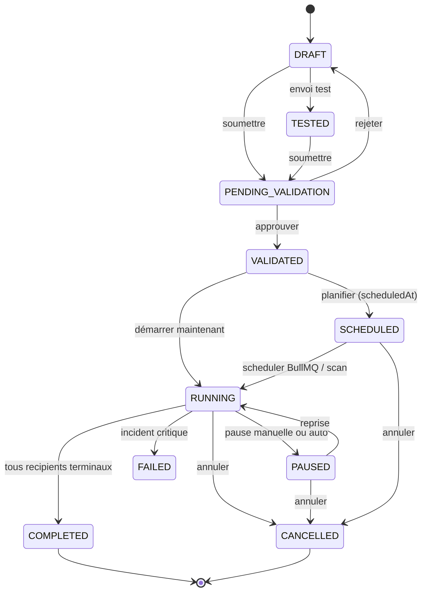
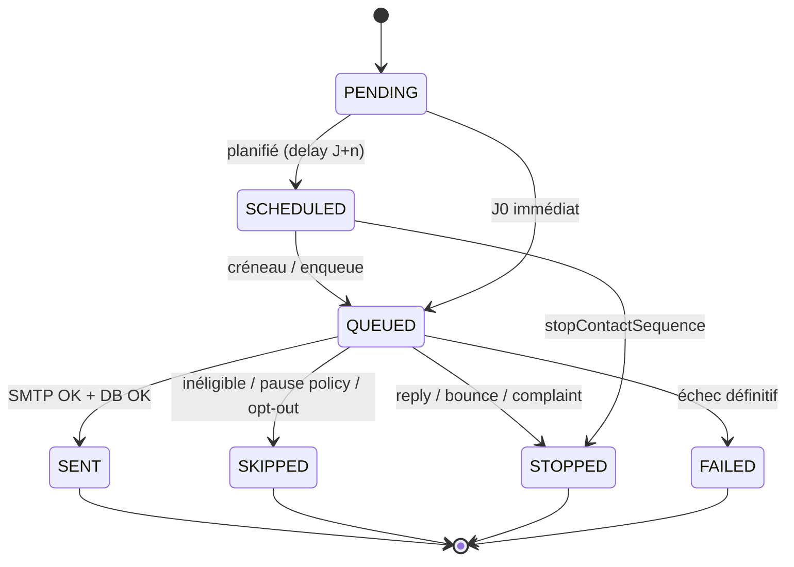
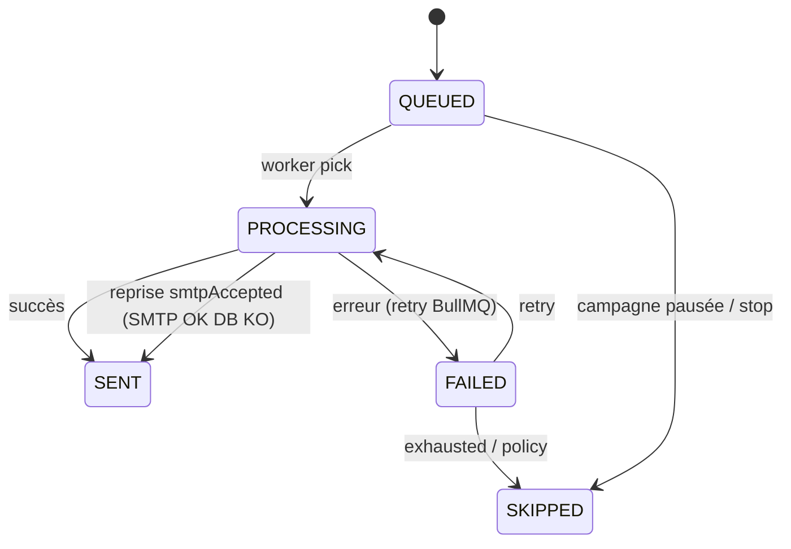
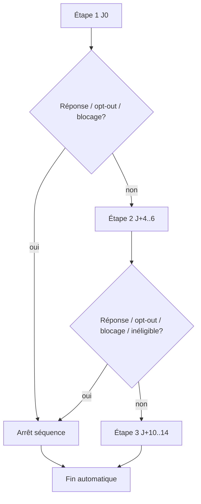
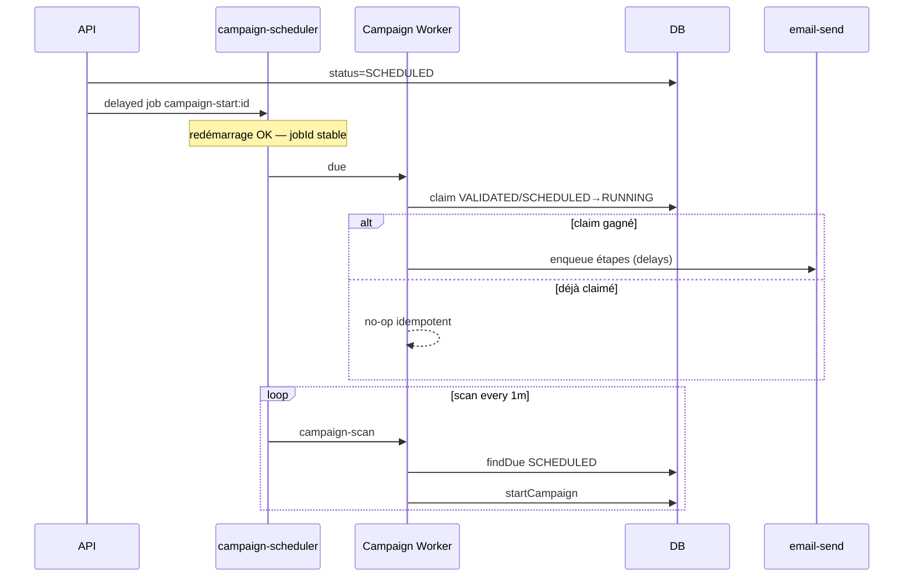

# Phase 4 — Machines à états

## Campagne

### Transitions critiques

| Transition | Garantie |
|------------|----------|
| `SCHEDULED → RUNNING` | `updateMany` atomique (multi-instance) |
| `RUNNING → PAUSED` | Jobs email retirés ; étapes conservées en DB |
| `PAUSED → RUNNING` | Recalcul créneaux ; pas de re-send SENT |
| `RUNNING → COMPLETED` | Aucun recipient PENDING/SCHEDULED/QUEUED actif |

## Recipient / étape

## SendAttempt

## Séquence contact (métier CDC)

## Scheduler

