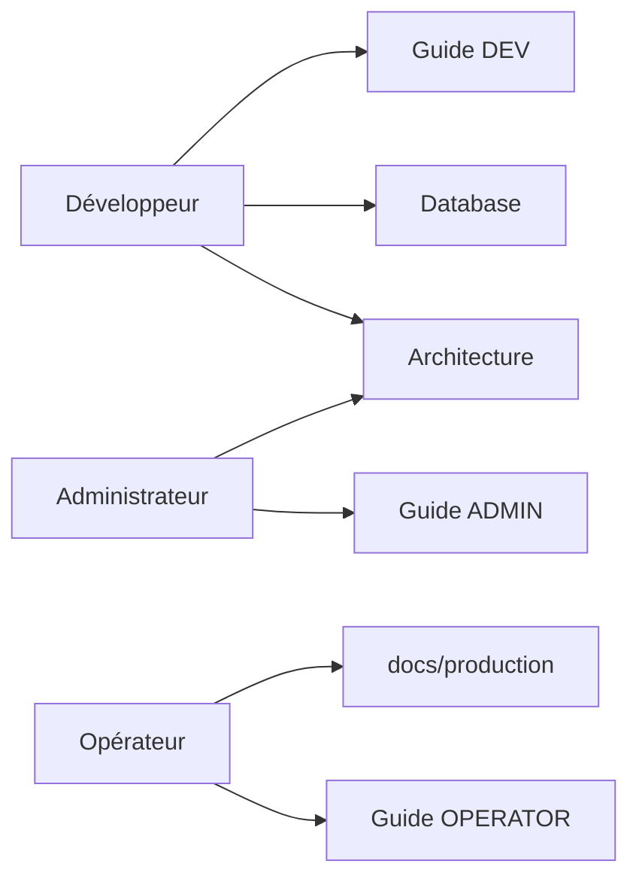

# Étape 6 — Documentation

Complétion de la documentation produit : architecture, diagrammes, séquence
d’envoi, modèle de données, guides développeur / admin / opérateur.

---

## 1. Livrables

| Document | Rôle |
|---|---|
| [Architecture.md](../Architecture.md) | Vue système, déploiement, **séquence d’envoi** (Mermaid), modules |
| [Database.md](../Database.md) | **Modèle de données** ER + tables + workflow campagnes |
| [guides/DEVELOPER.md](../guides/DEVELOPER.md) | Guide développeur |
| [guides/ADMIN.md](../guides/ADMIN.md) | Guide administrateur |
| [guides/OPERATOR.md](../guides/OPERATOR.md) | Guide opérateur |
| [guides/README.md](../guides/README.md) | Index des guides |

Corrections majeures Architecture :

- Suppression références obsolètes (`tsyringe` / `lib/di`)
- Alignement stacks Phase 11–14 + Étapes 3–5 (perf, sécu, obs)

---

## 2. Cartographie « qui lit quoi »

---

## 3. Pourquoi / Impact / Risque / Rollback

| Change | Pourquoi | Impact | Risque | Rollback |
|---|---|---|---|---|
| Docs Mermaid | Onboarding & incidents | MTTD / onboarding ↓ | Rendu GitHub requis | — |
| Guides séparés | Publics distincts | Moins de confusion | Divergence si non tenus | Mettre à jour avec les étapes |
| Arch à jour | Ancienne DI fausse | Moins d’erreurs setup | — | — |

---

## 4. Maintenance

À chaque changement de :

- gates d’envoi / queues → Architecture + OPERATOR
- schéma Prisma → Database
- RBAC / écrans métier → ADMIN
- scripts / structure `src/` → DEVELOPER
